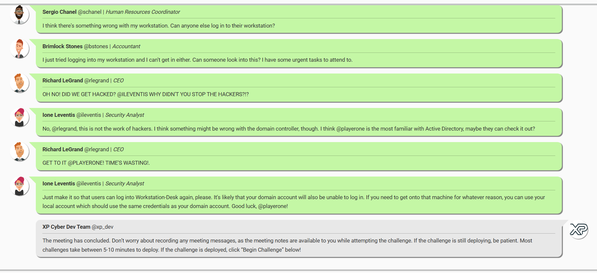
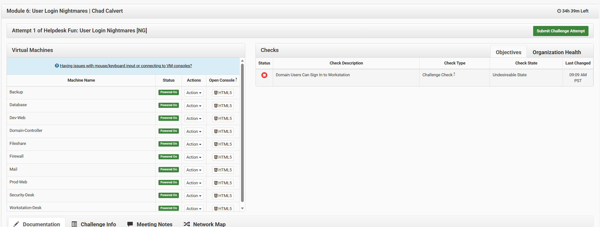
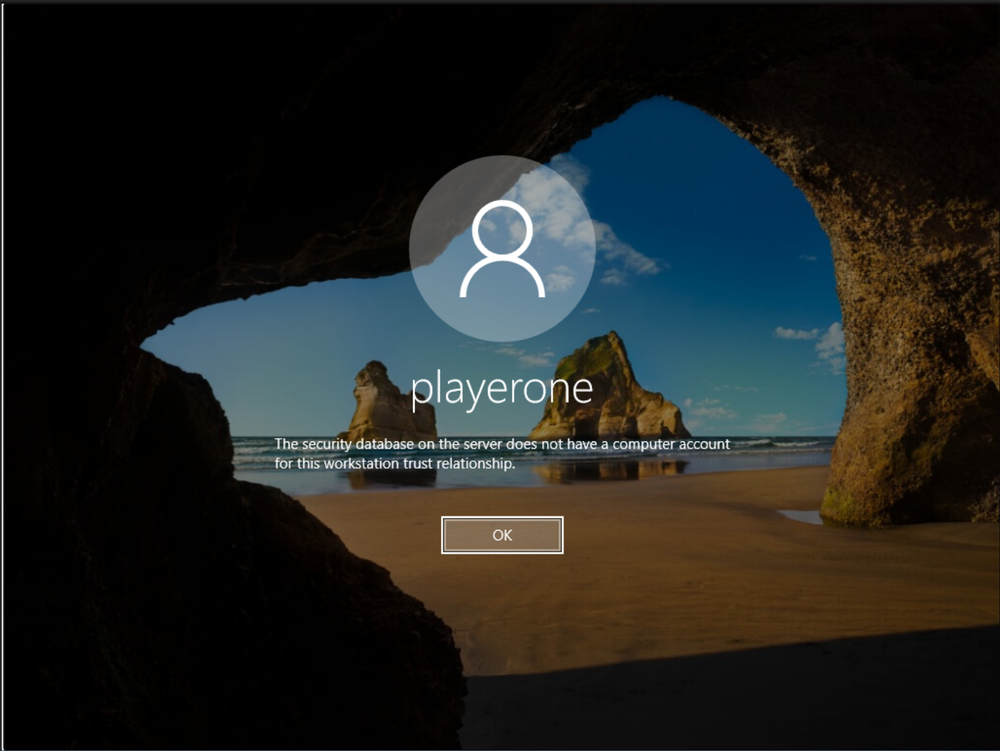
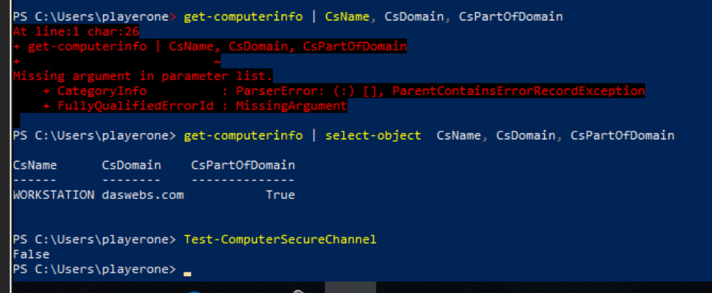
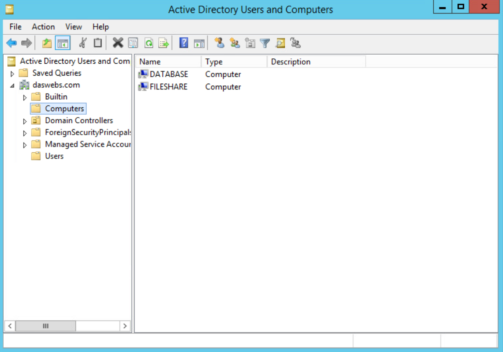
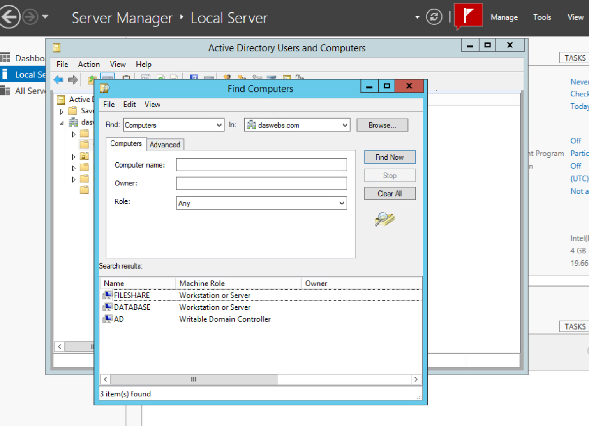
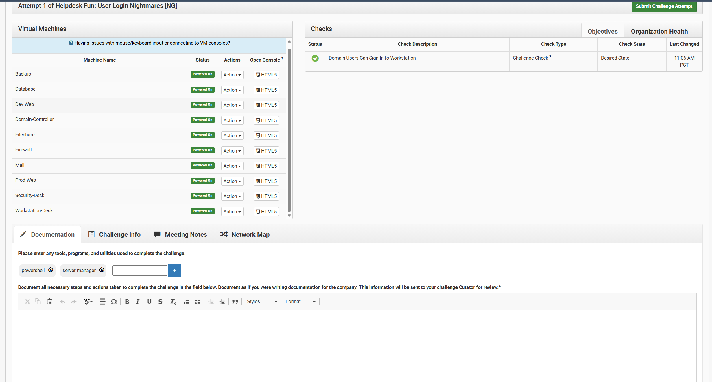

# Windows User Authentication Troubleshooting Lab

## Overview

This project documents a hands-on troubleshooting lab I completed through the XP Cyber Range as part of the **Helpdesk Fun: User Login Nightmares [NG]** challenge. The scenario involved multiple employees who were unable to sign in to their Windows workstations. My task was to investigate the authentication issue, identify what was preventing users from logging in, and restore access to the affected workstation. I used Windows PowerShell, Server Manager, and Active Directory Users and Computers to investigate the problem before making changes to the workstation's domain configuration.

## Lab Environment

- **Platform:** XP Cyber Range
- **Operating Systems:** Windows Server and Windows Workstation
- **Domain:** daswebs.com
- **Affected Computer:** WORKSTATION
- **Technologies:** Active Directory Domain Services, Windows Authentication, Domain Trust Relationships
- **Tools:** Windows PowerShell, Server Manager, Active Directory Users and Computers (ADUC), Windows System Properties

## Challenge Objective

The objective was to restore domain authentication so employees could sign in to Workstation-Desk again. The challenge started with reports from two employees who were unable to access their workstations. The security analyst suspected an issue with the domain controller, so I needed to investigate the workstation's connection to Active Directory and determine what was causing the authentication failure.

The initial XP Cyber Range validation check showed that domain users could not sign in to the workstation.

## Troubleshooting and Investigation

### Identifying the Authentication Issue

When I accessed Workstation-Desk, Windows displayed the following error:

> The security database on the server does not have a computer account for this workstation trust relationship.

Since I could not authenticate using the domain account, I logged in using the local administrator account. Based on the error message, I suspected that the workstation had lost its trust relationship with Active Directory, but I wanted to verify the issue before making any changes.

I opened PowerShell as Administrator and used the following command to check the workstation's computer name and domain membership:

`Get-ComputerInfo | Select-Object CsName, CsDomain, CsPartOfDomain`

The results confirmed that the computer was named WORKSTATION and was still configured as a member of the daswebs.com domain. I then ran `Test-ComputerSecureChannel` to verify whether the workstation could establish a secure connection with Active Directory. The command returned `False`, confirming that the trust relationship was broken.

### Investigating Active Directory

After confirming the secure channel issue, I accessed the domain controller and opened Active Directory Users and Computers through Server Manager. I checked the Computers container under daswebs.com and noticed that the DATABASE and FILESHARE computer accounts were present, but WORKSTATION was missing.

I wanted to make sure the computer account had not been moved somewhere else in Active Directory, so I used the Find feature and searched the entire domain. The results returned three computer accounts: DATABASE, FILESHARE, and AD. WORKSTATION was not listed anywhere in the search results. This confirmed that the workstation's computer account was missing from Active Directory and supported the cause of the authentication failure.

## Resolution

To restore domain authentication, I returned to Workstation-Desk and opened Windows System Properties using `sysdm.cpl`. Under the Computer Name tab, I selected Change and switched the workstation's membership from the daswebs.com domain to WORKGROUP. After applying the changes, I restarted the workstation and logged back in using the local administrator account.

Once the workstation restarted, I opened System Properties again and changed its membership from WORKGROUP back to the daswebs.com domain. I provided the required domain credentials and restarted the computer to complete the process. Rejoining the domain allowed the workstation to establish a new trust relationship with Active Directory and restored its domain authentication functionality.

## Verification and Results

After completing the repair, I returned to the XP Cyber Range dashboard to check whether the issue had been resolved. The validation check labeled **"Domain Users Can Sign In to Workstation"** displayed a green checkmark with the status **"Desired State."** This confirmed that the workstation met the challenge's authentication requirement and that the repair was successful.

**Final Result: Full Check Pass — 1/1**

## What I Learned

This lab gave me hands-on experience troubleshooting Active Directory authentication issues instead of just learning about them in theory. I had previously worked with Windows administration and networking, but this challenge helped me better understand how important the trust relationship is between a domain-joined workstation and its domain controller. I also got more practice using PowerShell to verify system configurations and troubleshoot authentication problems. One of the biggest takeaways was learning how to investigate the issue before attempting a repair. By checking the secure channel and searching Active Directory for the missing computer account, I was able to identify the problem and restore authentication without making unnecessary changes to other systems.
